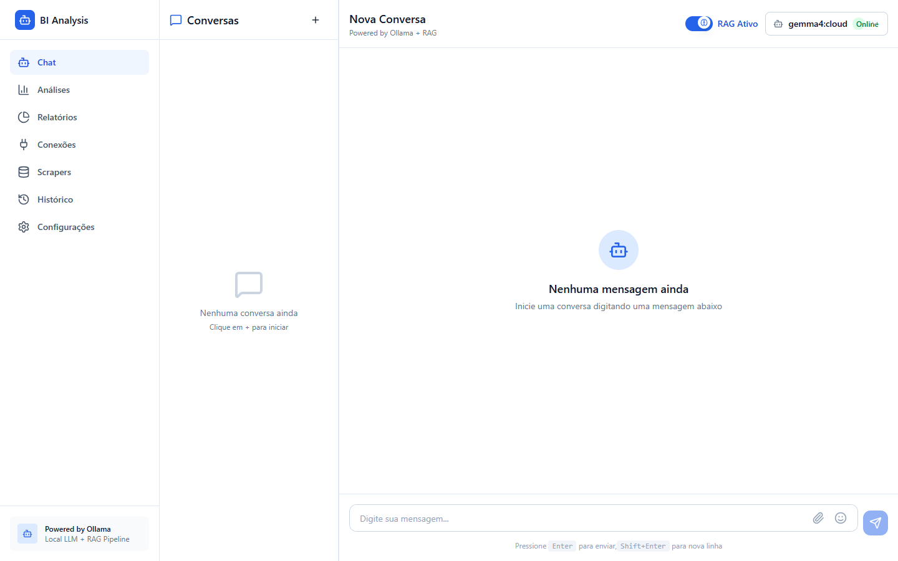
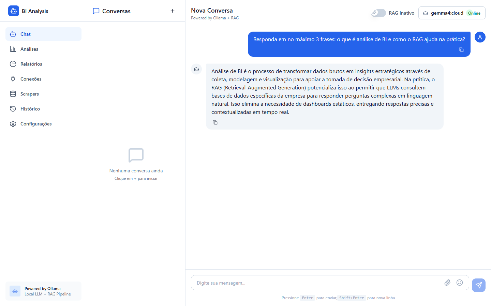
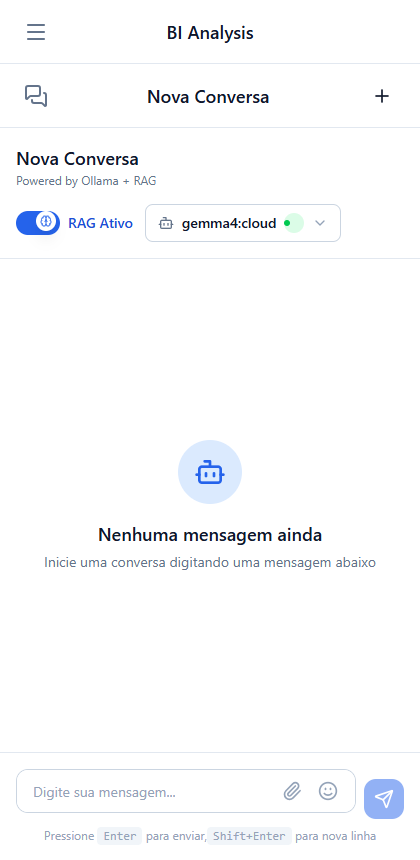
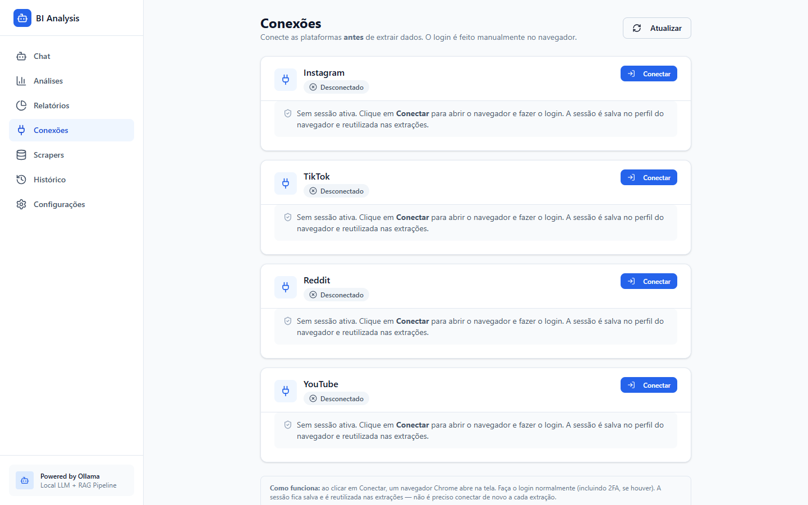
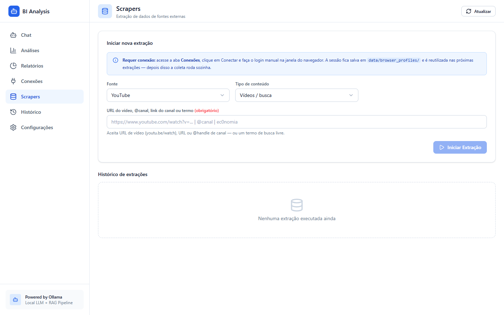
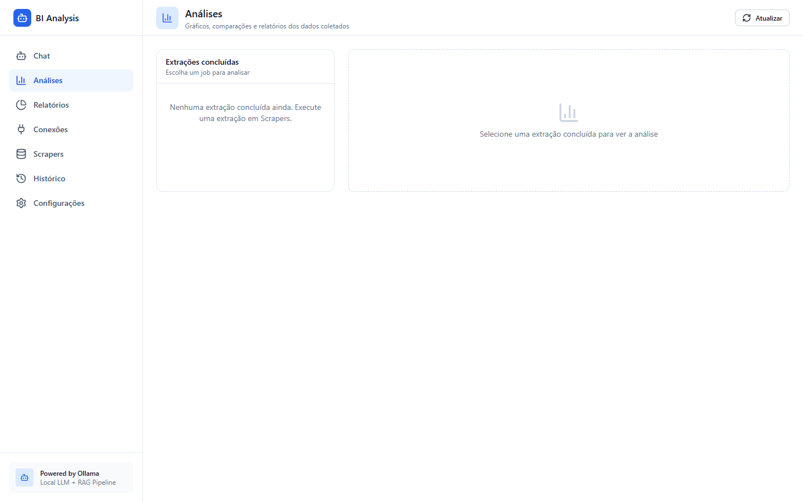
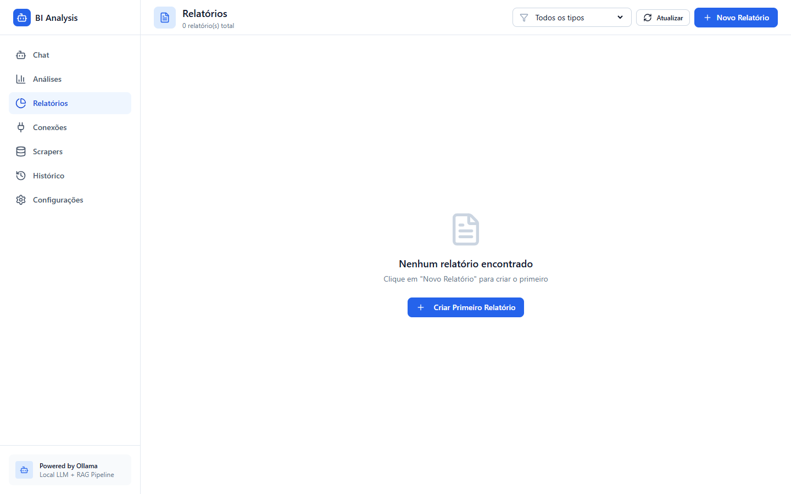
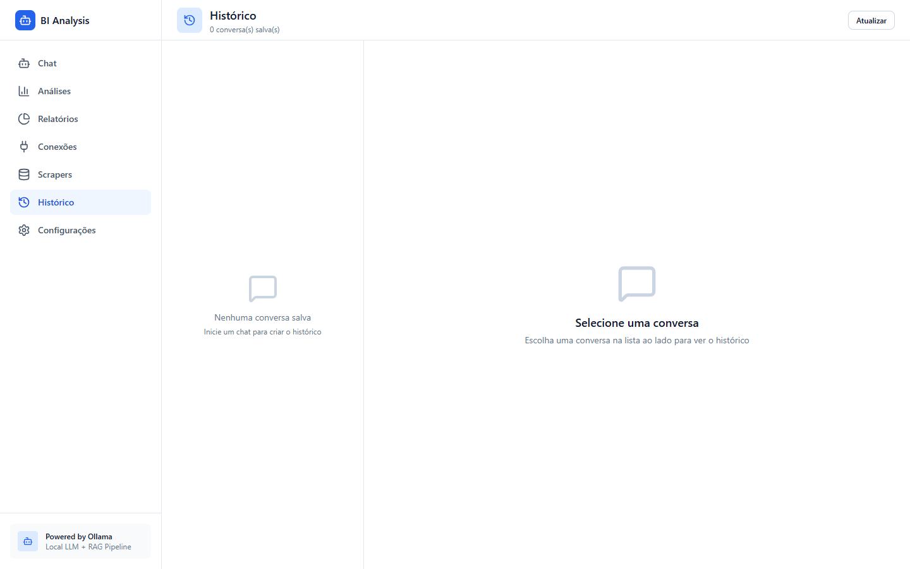
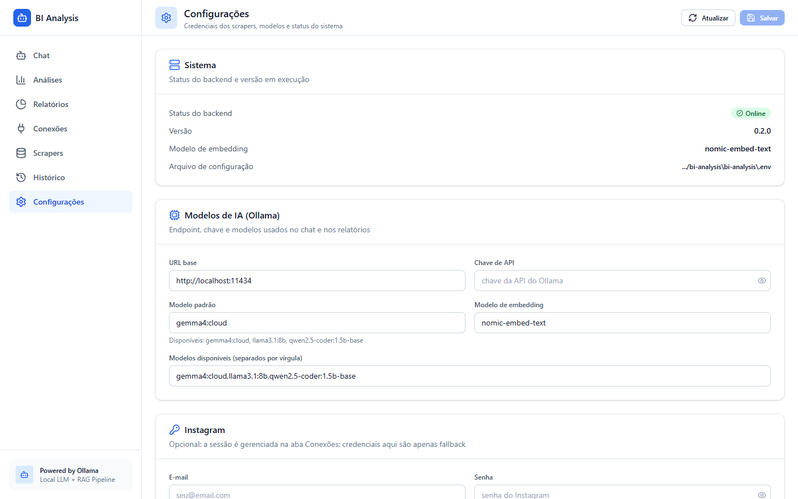

# BI Analysis

Plataforma de **Business Intelligence com IA**: extraia dados de redes sociais e fontes públicas, indexe em um banco vetorial e converse com os dados em linguagem natural (RAG + LLM via Ollama).



## O que a ferramenta faz

- **Extração multi-fonte**: Instagram, TikTok, YouTube, Reddit e Wikipédia — com login manual em janela visível e sessão salva para reutilizar
- **Entrada flexível**: cole a URL de um post/vídeo/página, digite o `@perfil` ou apenas um termo de busca
- **Painel de Análises**: métricas normalizadas, rankings, gráficos e série temporal dos dados coletados
- **Chat com RAG**: pergunte sobre os dados extraídos; o sistema busca os trechos relevantes no banco vetorial (Chroma) antes de gerar a resposta com o LLM
- **Relatórios com IA**: gere relatórios em linguagem natural a partir de qualquer extração concluída
- **Histórico**: todas as conversas ficam salvas e podem ser retomadas
- **Configurações pela interface**: endpoint do Ollama, chaves, modelos e credenciais dos scrapers (persistidas no `.env`)

## Interface

| Chat | Conversa com IA |
|:---:|:---:|
|  |  |

| Versão mobile | Conexões |
|:---:|:---:|
|  |  |

| Scrapers | Análises |
|:---:|:---:|
|  |  |

| Relatórios | Histórico | Configurações |
|:---:|:---:|:---:|
|  |  |  |

## Fluxo de uso

1. **Conexões** → clique em *Conectar* para Instagram/TikTok/YouTube/Reddit; abre um Chrome visível, faça o login uma vez (inclusive 2FA) — a sessão fica salva em `data/browser_profiles/` e é reutilizada
2. **Scrapers** → escolha a fonte e o tipo de conteúdo, informe a URL/`@handle`/termo e clique em *Iniciar Extração*
3. **Análises** → selecione uma extração concluída para ver métricas, rankings e gráficos
4. **Chat** → pergunte sobre os dados coletados com o RAG ativo, ou converse livremente com o modelo
5. **Relatórios** → gere relatórios completos com IA a partir das extrações

## Arquitetura

```
frontend/   React + Vite + TypeScript + Tailwind (SPA servida em /)
backend/    FastAPI (web/api/*) + pacote bi_analysis/
            ├── scrapers/    orquestração das extrações
            ├── sessions/    login manual + perfis de navegador (Selenium)
            ├── vector_store/ ChromaDB (base do RAG)
            ├── rag/         pipeline de recuperação + geração
            └── llm/         cliente Ollama (local ou cloud)
data/       bi_analysis.db (SQLite) + vector_store/ + browser_profiles/ + sessions/
```

## Requisitos

- Python 3.11+ (com [uv](https://docs.astral.sh/uv/) recomendado) e/ou pip
- Node.js 18+ (apenas para desenvolvimento/build do frontend)
- [Ollama](https://ollama.com) rodando — local (`http://localhost:11434`) ou cloud (`https://api.ollama.com`)
- Google Chrome (usado pelas extrações e pelo login manual)

## Início rápido

### Com uv (recomendado)

```bash
uv sync
uv run python -c "from bi_analysis.database.session import init_db; init_db()"
uv run bi-web            # API + interface em http://localhost:8000/
```

### Com pip

```bash
pip install -r requirements.txt
python -c "from bi_analysis.database.session import init_db; init_db()"
bi-web                   # ou: cd backend && python -m web.main
```

### Desenvolvimento (hot reload)

```bash
node run.js              # backend em :8000 + Vite em :5173
```

> Se a interface mostrar "Frontend not built", gere o build uma vez:
> `cd frontend && npm install && npm run build` — o backend serve `frontend/dist/` automaticamente.

## Configuração

Copie `.env.example` para `.env` e ajuste:

| Variável | Descrição |
|---|---|
| `OLLAMA_BASE_URL` | `http://localhost:11434` (local) ou `https://api.ollama.com` (cloud) |
| `OLLAMA_API_KEY` | Chave da API Ollama Cloud (não necessária para uso local) |
| `OLLAMA_MODEL` | Modelo padrão do chat (ex.: `gemma4:cloud`) |
| `OLLAMA_EMBEDDING_MODEL` | Modelo de embeddings do RAG (ex.: `nomic-embed-text`) |
| `OLLAMA_AVAILABLE_MODELS` | Modelos mostrados no seletor, separados por vírgula |
| `INSTAGRAM_EMAIL` / `INSTAGRAM_PASSWORD` | Credenciais opcionais (fallback do login manual) |

As configurações também podem ser editadas pela aba **Configurações** da interface — são aplicadas na hora e persistidas no `.env`.

## API

- `GET /api/health` — status do backend
- `GET /api/models` — modelos disponíveis
- `GET /api/settings` · `PUT /api/settings` — ler/atualizar configurações
- `POST /api/chat` — chat com RAG (streaming)
- `GET /api/chat/sessions` · `GET /api/chat/sessions/{id}/messages` — conversas
- `POST /api/extraction` · `GET /api/extraction` — extrações
- `GET /api/extraction/{job_id}/analise` — métricas normalizadas, rankings e série temporal
- `POST /api/reports` · `GET /api/reports` — relatórios
- `GET /api/sessions` · `POST /api/sessions/{fonte}/login` — estado e login manual das conexões

## Resetar os dados

Para voltar ao zero (como uma instalação recém-feita):

```bash
# pare o backend e apague todos os dados gerados
rm -rf data/bi_analysis.db data/vector_store data/browser_profiles data/sessions
```

Ou apague a pasta `data/` inteira — ela é recriada automaticamente no próximo start.

- **Conversas, extrações e base vetorial** zeram
- **Perfis de navegador** são recriados: o próximo login em Conexões abre um Chrome limpo, nunca usado
- O `.env` (suas chaves e credenciais) **não** é afetado

## Notas

- O login das redes sociais é sempre **manual** em uma janela visível (anti-bot/captcha); a sessão fica salva localmente em `data/browser_profiles/`
- As capturas deste README usam o tema claro nativo da interface
